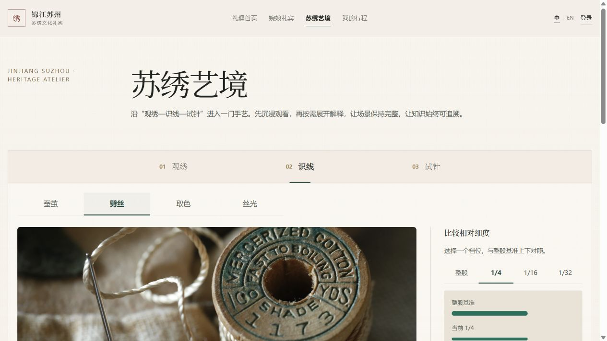

# 新版 ZIP 整合记录 · 2026-10-06

源文件：`D:\App\Chatgpt Codex\jinjiang-ai-ich.zip`。

主项目保留为 `D:\App\Chatgpt Codex\jinjiang-ai-ich`。`jinjiang-ai-ich2` 是旧 ZIP 的重复解压目录，不是第二个正式项目；比较后没有发现独有的项目文件，已备份并删除。原 Git 目录、分支与历史保留，没有提交、推送、部署、数据库迁移或在线密码修改。

## 整合内容

- 导入识线材料观察、细度 / 取色 / 丝光等交互及对应样式，保留既有悬浮婉娘助手。
- 导入共享 ROI 假设、前端 / Python 统一计算、统计快照和经营证据门槛。所有经营预测仍是合成假设，不能作为真实收入或到课证据。
- 导入新包的服务端资料检索、真实来源元数据、流式取消处理、共用 v3 契约及 Netlify Origin 白名单。原核心系统知识哈希、模型参数、推荐解释和 SSE 事件兼容性仍通过回归；新包增加的检索上下文与来源字段属于本次版本变化，不应声称请求路径完全无变化。
- 新包登录页只保留住客快捷填充。运营账户改为手工登录，公开演示构建不包含运营凭据。原环境已备份；本地运营参考保存在被 Git 忽略的 `web/.env.demo.local` 非 VITE 变量中，不复制到报告。
- 保留 2026-10-05 的默认静音、语音取消 / 清理、晚结果抑制、明确否定分类、关键词表达倾向措辞、严格 JSON 简报校验和安全排错日志。
- 合并新的下颚律动订阅，同时保留眨眼计时器及暂停清理；原脸和旧口型关闭策略保留。
- 原图 / 实验预览移至 `assets-source/wanniang-puppet`，生产静态资源只保留运行素材。未新增第三方模型或口型贴片。
- 导入同学的课程报告、证据与周报资料。它们是同学提供的版本，里面的历史测试 / 云端结论不是本次重新核实的事实。
- 没有导入 ZIP 的依赖缓存、Python 虚拟环境、旧 dist、编辑器缓存或 Git 目录；没有恢复已删除且曾被安全软件拦截的 `start-preview.ps1`。保留直接启动 Vite 的本地 `.bat`。

## 本次检查

| 检查 | 结果 |
| --- | --- |
| Vitest | 13 个文件，127 项通过，包括两版测试及严格简报 / 语音修复回归 |
| TypeScript | 通过 |
| 演示生产构建 | 通过，635 个模块 |
| 产物检查 | 独立演示后端正确、无运营凭据、材料交互已包含、开发图不进入产物、运行人物图存在 |
| Git diff 格式 | 通过 |
| 本地浏览器 | 识线导航、劈丝 1/32 选择、住客登录入口、婉娘默认静音与悬浮入口正常显示 |
| Python / TypeScript ROI 对照 | 已包含在通过的前端测试中，使用本机缓存 Python |
| Python 完整分析重算测试 | 尚未通过：当前 Python 缺少 scikit-learn；未安装依赖。网页使用已导入快照和前端 ROI，不依赖运行 Python 服务 |
| 云端认证、真实模型、真实 Azure | 本轮未进行在线写入或发布验收 |

## 备份与后续

备份目录：`D:\App\Chatgpt Codex\backups\整合前_20261006`。

- `主项目整合前.zip`：主项目工作文件，包括此前未提交内容；依赖与构建缓存不在备份范围。
- `旧重复目录jinjiang-ai-ich2.zip`：删除前备份；删除前逐文件验证了 228 个工作文件的 SHA-256。
- `git-status-before.txt`：整合前状态。

备份可能含本地环境配置，只在本地保留，不上传到 GitHub 或课程附件。主项目 `.git` 没有删除或覆盖。

后续若发布，应提交全部新模块与素材移动，先确认 Supabase 演示项目 `uxfxhqdfrzkafekrbzcf`，再核对 Netlify 构建环境。新的构建策略会拒绝公开 VITE 运营凭据；若控制台仍存在旧 `VITE_DEMO_OPS_*`，需要清理后构建。不要把公开演示连接到早期普通项目。
